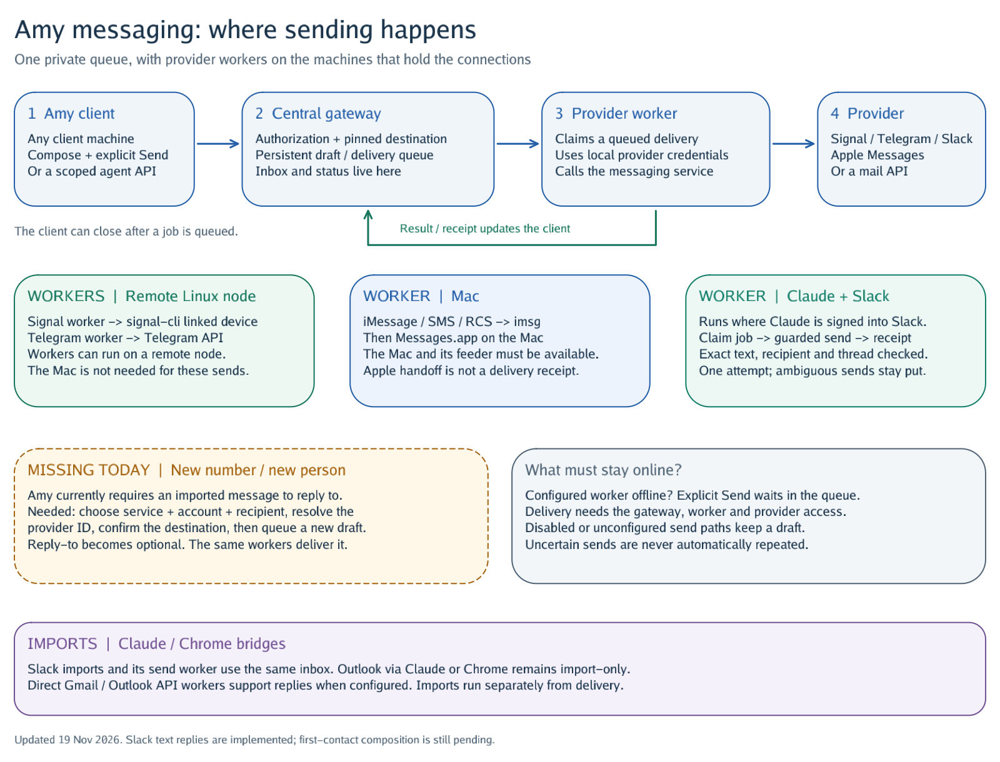

# Messaging architecture

[Download the PNG](assets/messaging-architecture.png) ·
[Editable canvas operations](assets/messaging-architecture.json)

Amy's UI and authorized agents submit reviewed messages to the private gateway.
The gateway owns drafts, queued deliveries, account scope and permissions.
A worker on the machine connected to the provider claims a delivery, rechecks
authorization, sends through that provider and reports a native receipt.

The worker can be on a different machine from Amy. iMessage needs the connected
Mac; Signal and Telegram can run on a remote node. The Slack worker runs wherever
Claude has the authenticated Slack connection. Direct Gmail and Outlook workers
use their configured API connections. Claude/Chrome Outlook imports remain
read-only.

An explicit Send queues while a registered, send-enabled worker is offline.
An unconfigured or disabled send path leaves a draft. Queued work survives
gateway restarts. Permissions and chat scope are checked again when a worker
returns. A failed connection after sending may leave an uncertain delivery;
workers replay receipts, never automatically repeat an ambiguous send.

Replies need an imported conversation/message today. A first-contact composer
for a new number or recipient is not yet implemented. Slack currently supports
text replies to the selected channel, DM or existing thread, and starting a
thread under a channel or DM message.

The diagram uses generic examples and contains no account IDs, addresses,
private hostnames or message content. Its JSON is a complete native canvas
operations file; import it with `amy canvas ops <canvas-id> -file <path>`.
Regenerate the PNG with `amy canvas export <canvas-id> -o <path>` after edits.

Provider setup: [Slack worker and agent imports](agent-messages.md),
[iMessage](imessage.md), [Signal](signal.md), [mail](mail.md).
